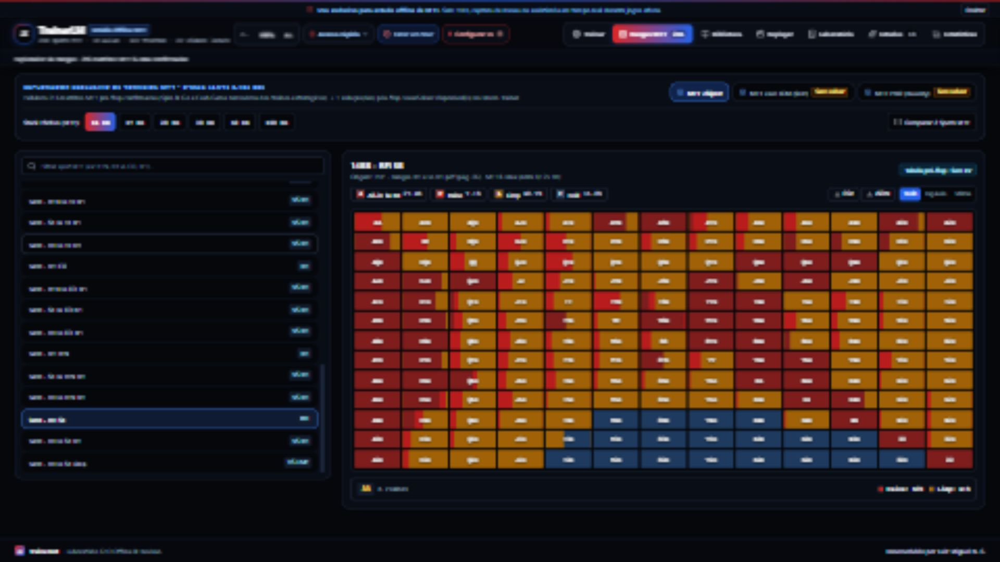
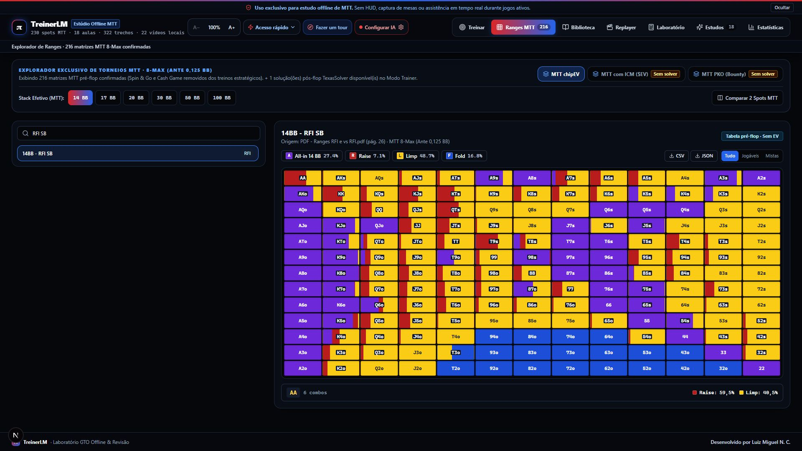
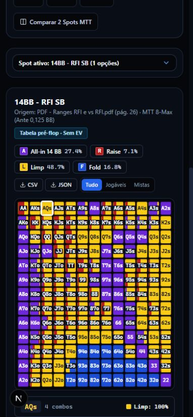
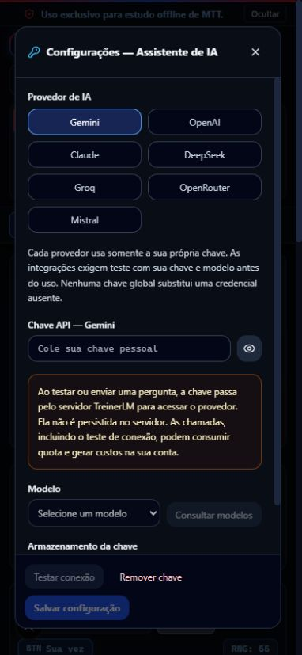

# TreinerLM — IA multiprovedor e cores de ranges

Implementação: 16–17/11/2026. Inspeção final: 17/11/2026 (America/Fortaleza).

Este relatório distingue implementação, testes simulados e homologação real. **Nenhum provedor está homologado com chave real nesta entrega.** Não foram fornecidas credenciais para chamadas autorizadas. A versão pública foi inspecionada, mas estas alterações não foram publicadas. Nenhum commit foi criado.

## 1. Arquitetura dos provedores

Fluxo: navegador → `POST /api/coach` → adaptador fixo do provedor → navegador. O contrato comum fica em `app/src/lib/ai/types.ts`, o registro em `providerRegistry.ts`, os filtros de capacidades em `modelCatalog.ts`, a política de segurança em `security.ts` e os protocolos em `providers/`. Credenciais e conversas não ficam em variáveis globais do servidor. Cada chamada possui seu próprio contexto e sinal de cancelamento.

Os clientes usam `client.ts` para requisições e leitura incremental, e `clientStorage.ts` para armazenamento independente por provedor. A interface permanece compartilhada entre todas as APIs.

## 2. APIs implementadas

| Provedor | Protocolo | Homologação real |
| --- | --- | --- |
| Gemini | generateContent / streamGenerateContent | Pendente |
| OpenAI | Responses, sem persistência de resposta solicitada pela aplicação | Pendente |
| Claude | Anthropic Messages | Pendente |
| DeepSeek | Chat Completions | Pendente |
| Groq | Chat Completions | Pendente |
| OpenRouter | Chat Completions | Pendente |
| Mistral | Chat Completions | Pendente |
| Ollama | API local de chat, habilitação explícita | Pendente; instalação local não confirmada |

## 3. Pendências de homologação

É necessário executar uma chamada real autorizada por provedor e modelo pretendido. Passar em mocks não confirma saldo, permissões, disponibilidade regional, IDs acessíveis à conta ou compatibilidade real com futuras versões dos serviços. O botão **Testar conexão** realiza essa chamada e informa que pode haver cobrança. A aplicação exige teste bem-sucedido da combinação chave/modelo antes de habilitar o chat.

## 4. Descoberta de modelos e capacidades

A lista é consultada no backend com a chave do provedor selecionado, inclusive antes da inferência, sem cache compartilhado entre credenciais. IDs vêm das APIs; não há seleção automática de um modelo pago ou substituição silenciosa quando um modelo desaparece. A listagem é filtrada para tarefas de texto/chat. Recursos de imagem desconhecidos ficam desativados. OpenAI usa uma lista de famílias/IDs documentados para Responses, intersectada com a descoberta autenticada; famílias novas precisam revisão explícita. Modelos aposentados e especializados são excluídos. O catálogo não inventa IDs disponíveis para a conta.

Listagem e autorização de inferência são verificações diferentes. A UI pede seleção explícita e teste de inferência. Streaming, limitações e disponibilidade acompanham os modelos; preços só podem ser mostrados quando retornados com confiança pelo serviço, sem estimativas inventadas.

## 5. Segurança das credenciais

- Chaves individuais são enviadas somente no corpo JSON entre navegador e TreinerLM e em cabeçalhos apropriados do provedor. Nunca são colocadas em query strings.
- O backend não salva chaves pessoais, não faz fallback para `GEMINI_API_KEY` ou outra chave global e não devolve erros brutos dos provedores.
- As requisições usam destinos fixos, não seguem redirecionamentos e não aceitam uma URL arbitrária de provedor. Ollama possui destino loopback fixo, exclusivamente local e opt-in.
- A origem pública exige HTTPS e lista autorizada. Há validação de provedor, modelo, histórico, imagens e limites de conteúdo. Respostas usam `Cache-Control: no-store`.
- O padrão de armazenamento é `sessionStorage`, por aba/sessão. **Lembrar neste navegador** exige escolha explícita e avisa que `localStorage` não cifra o segredo e pode ser lido por pessoas com acesso ao perfil ou scripts da página. O TreinerLM não sincroniza chaves entre dispositivos.
- O armazenamento antigo de Gemini, que persistia sem consentimento explícito, é removido sem importar silenciosamente o segredo.
- Conversas ficam na memória da tela. Trocar de provedor inicia conversa vazia por padrão; compartilhar texto anterior exige marcar a opção explícita. Anexos não são transferidos automaticamente.

A garantia é sobre o código desta aplicação. O proprietário deve manter captura de corpos/cabeçalhos sensíveis desabilitada em qualquer proxy, analytics ou monitoramento que venha a adicionar. Cancelar interrompe a requisição e o fluxo local, mas não garante estorno de tokens já consumidos pelo provedor.

## 6. Funcionamento local

Em `app/`: `npm install`, `npm run dev`, depois abrir o endereço local. Configurar a chave na interface; visitantes não precisam editar arquivos de ambiente. As rotas de SQLite continuam sob a política local existente, separadas do acesso ao coach.

Ollama só aparece quando o proprietário define `TREINERLM_OLLAMA_ENABLED=1` no processo local e disponibiliza modelos em `http://127.0.0.1:11434`. Não há URL configurável pelo visitante. A ativação não instala Ollama nem baixa modelos. A variável é ignorada em Vercel.

A API local do Ollama também pode encaminhar pedidos a serviços cloud. O adaptador bloqueia nomes de modelos cloud e metadados `remote_host`/`remote_model` na descoberta e inspeção. Para manter o próprio serviço Ollama estritamente offline, o proprietário deve configurar `OLLAMA_NO_CLOUD=1` **no processo do Ollama**, conforme a [FAQ oficial](https://github.com/ollama/ollama/blob/main/docs/faq.mdx). Definir isso apenas no processo Next.js não reconfigura um Ollama já em execução. A [documentação de modelos cloud](https://docs.ollama.com/cloud/models) e o [esquema oficial de modelos](https://github.com/ollama/ollama/blob/main/api/types.go) fundamentam esse bloqueio.

## 7. Funcionamento na Vercel e controle de abuso

A rota é compatível com o runtime Node do Next.js e mantém a autenticação existente do projeto. O domínio público autorizado padrão é `https://trainer-3-14.vercel.app`; o domínio do deploy em `VERCEL_URL` e uma origem adicional em `TREINERLM_PUBLIC_ORIGIN` são considerados pela política dedicada de IA.

Para consultas públicas, configurar um contador compartilhado Upstash Redis com:

```dotenv
TREINERLM_AI_REDIS_REST_URL=https://seu-banco.upstash.io
TREINERLM_AI_REDIS_REST_TOKEN=token_rest_do_proprietario
TREINERLM_AI_RATE_SECRET=segredo_aleatorio_de_pelo_menos_32_caracteres
```

Esses valores são segredos de infraestrutura do proprietário, nunca chaves pessoais de visitantes e nunca variáveis `NEXT_PUBLIC_*`. O contador usa operação atômica e expiração curta. Sem configuração válida ou com falha do contador, a IA pública responde 503 antes de consultar qualquer provedor. Localmente há limite em memória, adequado à instância do computador.

Limites implementados: 20 requisições/minuto por origem de cliente e 200/minuto no total público, contados de forma atômica em janelas fixas; 20/minuto na instância local. O Redis recebe somente contadores com identificação HMAC e expiração de 120 segundos, sem IP puro, prompt ou chave pessoal. Cada consulta tem prazo de 55 segundos, e a função declara `maxDuration = 60`. Corpo máximo: 4 MiB público e 6 MiB local. O campo de pergunta aceita 8.000 caracteres; histórico aceita até 20 mensagens anteriores, com 8.000 caracteres por mensagem e 32.000 no total. A UI limita imagens a 2,5 MiB antes de codificar em base64.

A [documentação da Vercel sobre limites de Functions](https://vercel.com/docs/functions/limitations) estabelece 4,5 MB para payloads não transmitidos em streaming. O limite público da aplicação deve ficar abaixo desse teto. A [API REST oficial do Upstash](https://upstash.com/docs/redis/features/restapi) permite comandos no corpo e autenticação por cabeçalho; não são enviados prompts ou chaves pessoais ao contador. Como proteção adicional, o proprietário pode configurar [WAF Rate Limiting da Vercel](https://vercel.com/docs/vercel-firewall/vercel-waf/rate-limiting).

## 8. Teste real controlado por provedor

Usar a interface: selecionar provedor → informar chave → **Consultar modelos** → selecionar ID → **Testar conexão** → **Salvar configuração**. Repetir para cada provedor. Não enviar chaves neste relatório, no chat, em argumentos de linha de comando ou em arquivos versionados.

Também foi preparado `npm run test:ai:live`, separado de `npm test`. Com servidor local em execução, definir no ambiente do processo `TREINERLM_AI_LIVE_TEST=1` e a variável da chave correspondente (`GEMINI_API_KEY`, `OPENAI_API_KEY`, `ANTHROPIC_API_KEY`, `DEEPSEEK_API_KEY`, `GROQ_API_KEY`, `OPENROUTER_API_KEY` ou `MISTRAL_API_KEY`). Esses valores são usados pelo script apenas para construir a requisição pessoal; não são fallback da aplicação.

```text
npm run test:ai:live -- --provider gemini --model ID_REAL_LISTADO --port 3000
```

O script primeiro descobre os modelos, confirma o ID e executa o teste real. Não troca de modelo nem registra chave ou conteúdo da resposta. O modo Ollama usa `--provider ollama` e dispensa chave. O script local pressupõe acesso local sem tela de login; se a instalação exigir autenticação, usar o teste pela interface autenticada.

## 9. Nova paleta de ações

Os tokens semânticos de apresentação ficam em `app/src/lib/poker/uiPresentation.ts`.

| Ação | Fundo | Texto | Identificação adicional |
| --- | --- | --- | --- |
| All-in | `#6D28D9` | `#FFFFFF` | A, rótulo e tooltip |
| Raise | `#B91C1C` | `#FFFFFF` | R, rótulo e tooltip |
| Limp | `#FACC15` | `#111827` | L, rótulo e tooltip |
| Fold | `#1D4ED8` | `#FFFFFF` | F, rótulo e tooltip |
| Call | `#047857` | `#FFFFFF` | C, rótulo e tooltip |
| Check | `#475569` | `#FFFFFF` | X, rótulo e tooltip |
| Bet | `#C2410C` | `#FFFFFF` | B, rótulo e tooltip |

Contrastes calculados em testes: All-in 7,10:1; Raise 6,47:1; Limp 11,58:1; Fold 6,70:1; Call 5,48:1; Check 7,58:1; Bet 5,18:1. Todos os pares normais e de hover passam WCAG AA para texto normal (mínimo 4,5:1).

Texto sobre Limp usa o par escuro; rótulos sobre misturas usam uma base contrastante própria. As distribuições mantêm os valores originais: sem normalização, sem ocultar segmentos pequenos e sem preencher resíduos como Fold fictício. Distribuições incompletas têm fundo residual neutro e aviso acessível. Bloqueios existentes de avaliação permanecem.

## 10. Comparação visual

Capturas em `docs/ia-multiprovedor-cores/`. Cenário de comparação: **14 BB — RFI SB**, que reúne All-in, Raise e Limp. Resoluções solicitadas: 1920×1080, 1440×900, 768×1024 e 390×844. Há também captura da configuração antiga na versão publicada. A inspeção não enviou nenhuma chave ou pergunta aos provedores.

Antes (instância local anterior):



Depois (código atualizado em servidor local separado):







Há capturas `antes-ranges-*`, `depois-ranges-*`, `depois-configuracoes-*` e `depois-assistente-*` nas quatro dimensões. As páginas verificadas não apresentaram overflow horizontal (largura do documento menor ou igual à viewport). No celular, há registro adicional da matriz após rolagem. O console não apresentou erros ou avisos durante a inspeção. A troca visual Gemini/OpenAI manteve rascunhos separados; apenas uma chave fictícia foi digitada e descartada, sem consultar modelos nem salvar configuração. A captura completa de página no tablet falhou na ferramenta; foram preservadas as capturas normais da viewport e a captura adicional da matriz móvel.

## 11. Arquivos modificados por esta entrega

- `app/src/lib/ai/`: contratos, registro, catálogo, segurança, armazenamento, cliente e adaptadores independentes.
- `app/src/app/api/coach/route.ts`: backend comum e streaming.
- `app/src/components/SettingsModal.tsx`, `AiCoachView.tsx`, `PokerStudioApp.tsx`, `SiteTour.tsx`: configuração e experiência compartilhadas.
- `app/src/lib/poker/uiPresentation.ts`, `RangeMatrix.tsx`, `TrainerView.tsx`, `CleanRangeTrainerView.tsx`, `PokerTable.tsx`, `InteractiveDrillsLab.tsx`: tokens, renderização e acessibilidade.
- Novos testes de IA, armazenamento e paleta; expectativas de paleta atualizadas em testes de apresentação.
- `app/scripts/test-ai-live.mjs`, `app/package.json`, `app/.env.local.example`, `README.md` e este relatório.

O workspace já continha mudanças independentes em autenticação, Biblioteca, Replayer e importador PokerStars. Elas foram preservadas e não fazem parte da implementação de IA/cores. A integração com `PokerStudioApp` e `TrainerView` conserva as funções dessas mudanças.

## 12. Verificações automatizadas

`npm test`: **200 testes passaram**, sem falhas, cancelamentos ou testes ignorados. `npm run lint`: passou sem erros. `npm run typecheck`: passou; a execução adicional durante a limpeza do build produziu um erro transitório de arquivos gerados em `.next/types` e será repetida sequencialmente ao concluir o build. O resultado do build será registrado abaixo após a conclusão.

Os novos testes incluem 24 casos de adaptadores/segurança (`aiProviders.test.ts`), cinco de cliente/armazenamento (`aiClient.test.ts`), nove da rota completa (`aiCoachRoute.test.ts`) e quatro da paleta (`actionPalette.test.ts`). A rota é exercitada em modo local e com ambiente Vercel simulado, incluindo contador distribuído, falha fechada, corpo público e bloqueio de Ollama. Há cobertura de chaves inválidas, quota, falha de rede, modelos indisponíveis, isolamento simultâneo entre credenciais, origem, SSRF, UTF-8 incremental, cancelamento, resposta truncada e remoção de chave refletida em chunks. O teste de imagem de 2,5 MiB confirma que a validação base64 não estoura a pilha de RegExp.

Os testes de ranges conferem os hashes originais de `ranges_gto.json` e `verified_ahkd7c_texassolver.json`, incluindo a conservação das estratégias, proveniência e cálculos. Logs desta verificação estão na pasta de evidências. O comando de homologação real também foi executado **sem opt-in** e recusou a chamada conforme esperado, antes de qualquer acesso a provedor.

## 13. Falhas encontradas e corrigidas

- Coach restrito a loopback: impedia uso no site publicado. Substituído por política específica de IA, mantendo as rotas locais privadas.
- Credencial Gemini persistida automaticamente e chave global implícita: substituídas por configuração pessoal com duração explícita.
- Modelos fixos sem descoberta por conta: substituídos por listagem real e teste do ID selecionado.
- Limp marrom e All-in vermelho escuro: substituídos por amarelo/escuro e roxo/branco.
- Renderização que omitiria segmentos pequenos e preencheria resíduos como Fold: substituída por segmentos proporcionais e resíduo neutro sinalizado.
- GET do navegador sem cabeçalho Origin: permitido sob validação de host, cabeçalho dedicado e origem cruzada recusada.
- Streaming com chunk menor que o buffer de remoção de segredo: corrigido para continuar lendo até emitir dados ou concluir, sem travar.
- Consumo parcial do Claude apagando tokens de entrada: agregação agora preserva os campos já recebidos.
- Regex de grupos repetidos sobre imagem base64 grande: substituída por validação linear com limite físico de corpo.

## 14. Limitações e evidências de integridade

Sem credenciais reais, não foram testados saldo, quota real, contas de cada serviço nem respostas reais. Sem publicação desta mudança, não há homologação do novo backend em produção. A viabilidade de Ollama depende da instalação e de modelos disponíveis no computador.

Ollama inspeciona no máximo 32 modelos instalados. O histórico não é resumido nem cortado silenciosamente: ao atingir os limites de quantidade/tamanho, o servidor pede uma nova conversa. O cancelamento não garante estorno de custos. Os limites públicos dependem da configuração de infraestrutura do proprietário; sua integração real com Redis também precisa ser confirmada no preview.

Os dados GTO, soluções TexasSolver e SQLite pessoal não foram editados por este trabalho. Hashes preservados: `ranges_gto.json` = `d46652c5bfe3ced09073fa68544e134683499f18eabdabef8202d9ee351cb60e`; `verified_ahkd7c_texassolver.json` = `868ef9fb8e6371f12dde7749170015af4facca70af92dc33aa45251cdd0b3eda`.

## 15. Orientações para publicação

1. Revisar o diff desta entrega juntamente com as mudanças preexistentes do workspace, sem incluir segredos.
2. Usar `app/` como Root Directory na Vercel e executar os quatro comandos de verificação.
3. Preservar a configuração existente de `TREINERLM_ACCESS_PASSWORD` e, se utilizada, `TREINERLM_AUTH_SECRET`.
4. Configurar os três valores de controle de abuso compartilhado e uma origem adicional apenas se houver domínio próprio. Não publicar chaves pessoais de IA em variáveis globais.
5. Publicar um preview, confirmar autenticação, descoberta de provedores, rejeição de origem externa, limite de corpo e bloqueio de rotas locais privadas.
6. Pela interface autenticada, testar uma chave real autorizada de cada provedor, incluindo cancelamento e indisponibilidade de modelo. Registrar somente provedor/modelo/data e resultado, nunca segredos.
7. Conferir o range 14 BB — RFI SB nas quatro resoluções e comparar com as capturas. Promover o preview somente após essas verificações.

Fontes oficiais consultadas para os protocolos e capacidades:

- [Gemini: modelos](https://ai.google.dev/api/models) e [generateContent](https://ai.google.dev/api/generate-content).
- [OpenAI: Responses](https://developers.openai.com/api/reference/resources/responses/methods/create) e [modelos](https://developers.openai.com/api/docs/models).
- [Claude: modelos](https://platform.claude.com/docs/en/api/models/list), [Messages](https://platform.claude.com/docs/en/api/http/messages/create), [versões de API](https://platform.claude.com/docs/en/api/versioning) e [visão](https://platform.claude.com/docs/en/build-with-claude/vision).
- [Groq: referência de APIs](https://console.groq.com/docs/api-reference).
- [OpenRouter: modelos filtrados pela conta](https://openrouter.ai/docs/api/api-reference/models/list-models-filtered-by-user-provider-preferences-privacy-settings-and-guardrails).
- [DeepSeek: descoberta de modelos](https://api-docs.deepseek.com/api/list-models/).
- [Mistral: modelos e capacidades](https://docs.mistral.ai/api/endpoint/models).
- [Ollama: chat](https://docs.ollama.com/api/chat) e [modelos locais](https://docs.ollama.com/api/tags).

As referências também ficam em `modelCatalog.ts`; o catálogo deve ser revisto quando os serviços mudarem suas capacidades.
