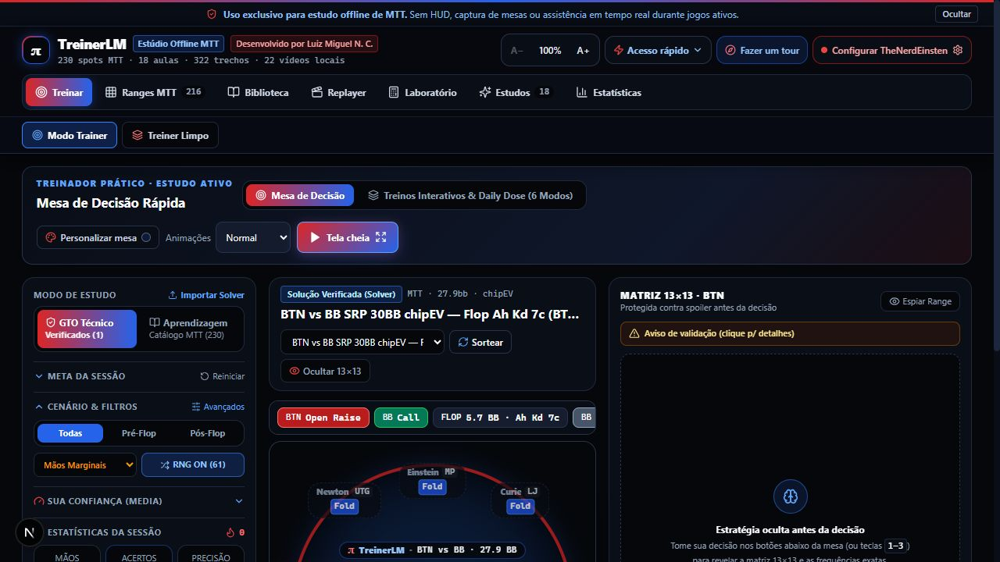
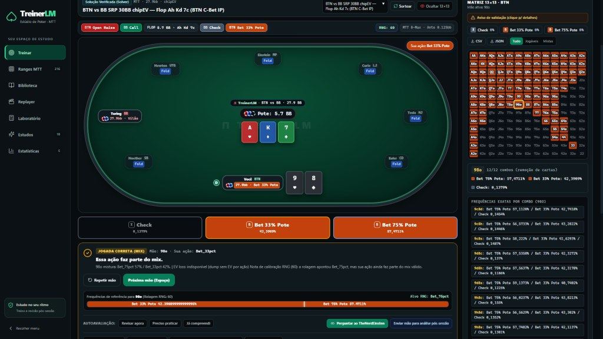
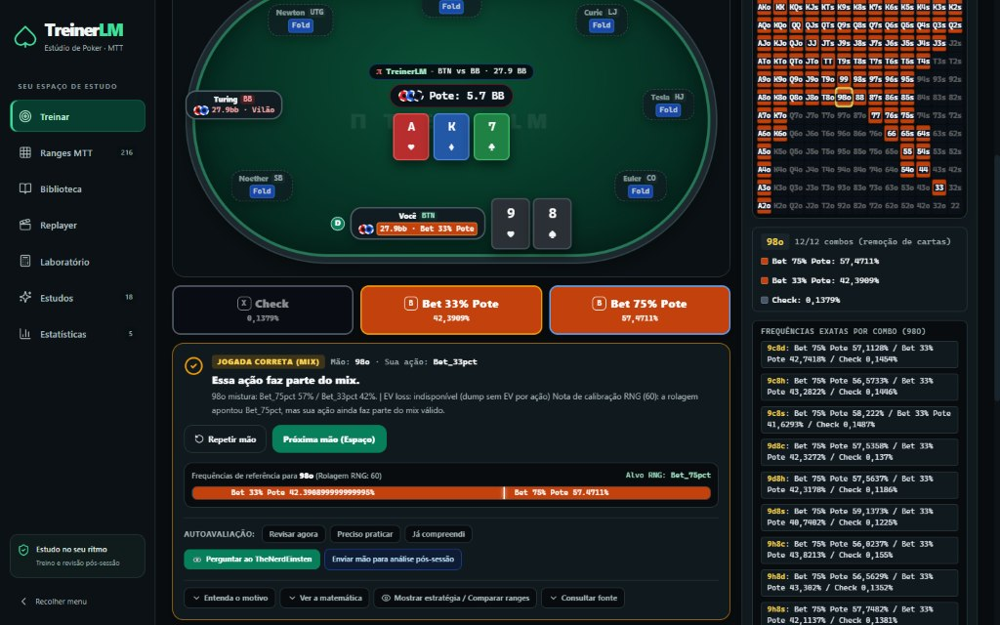
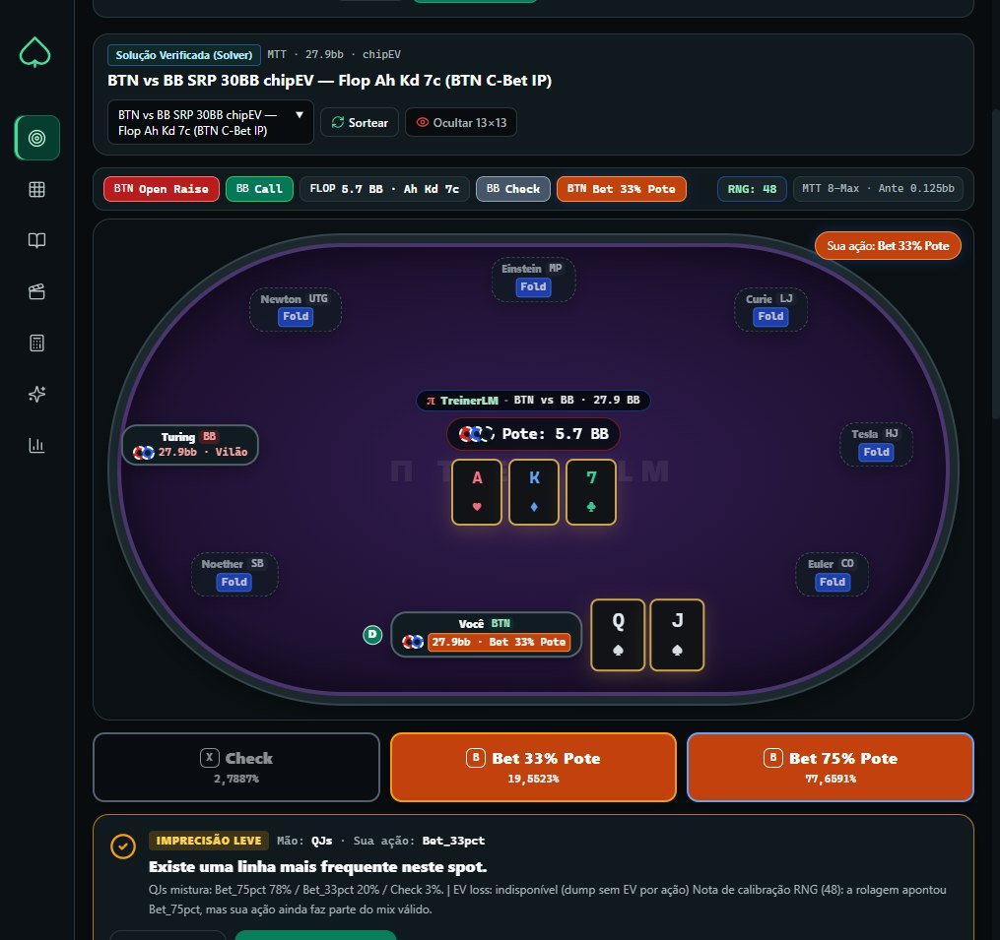
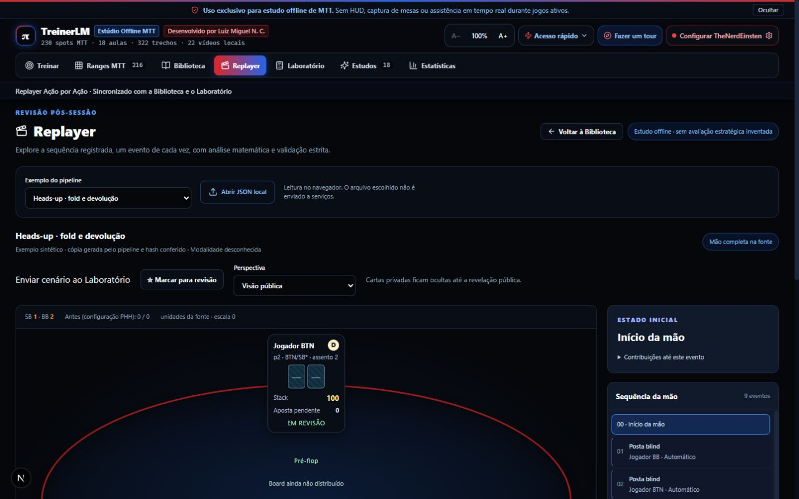
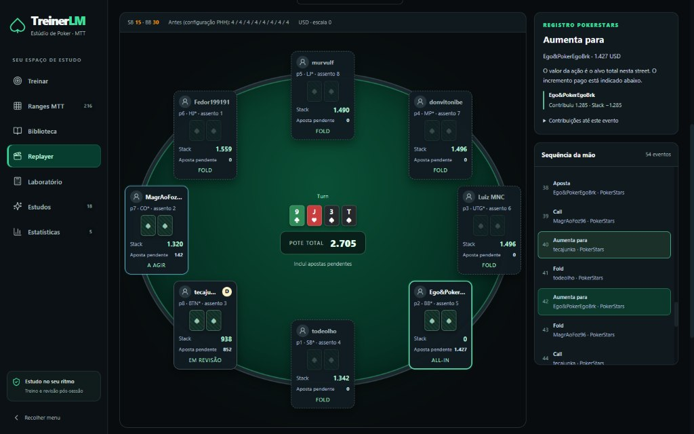
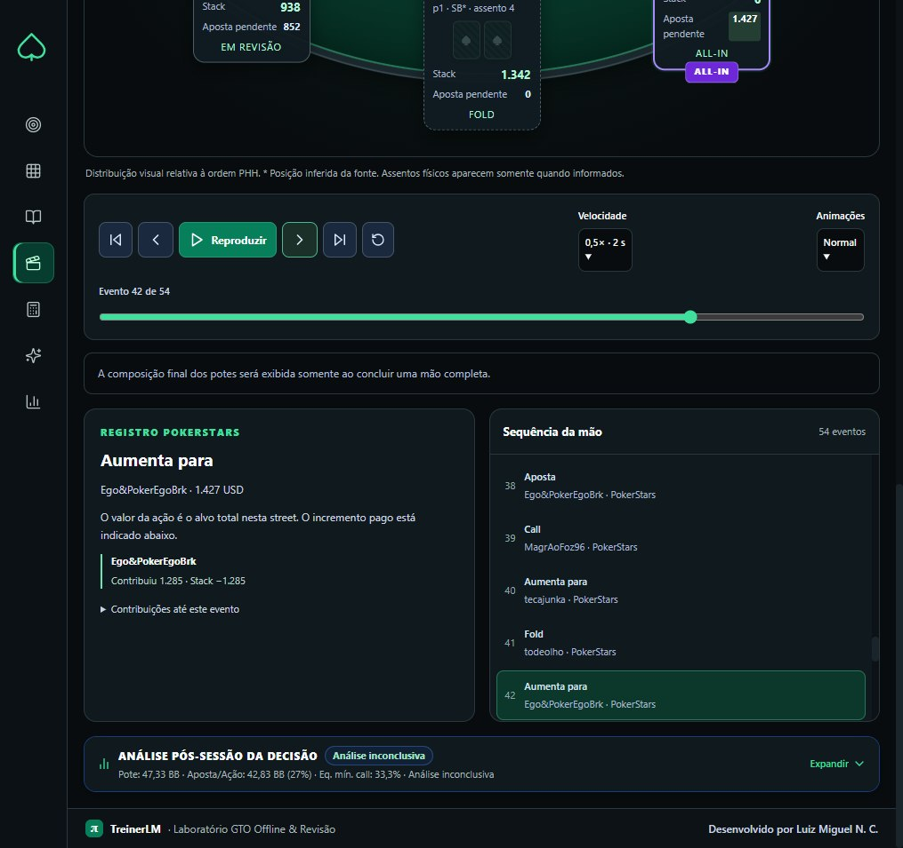
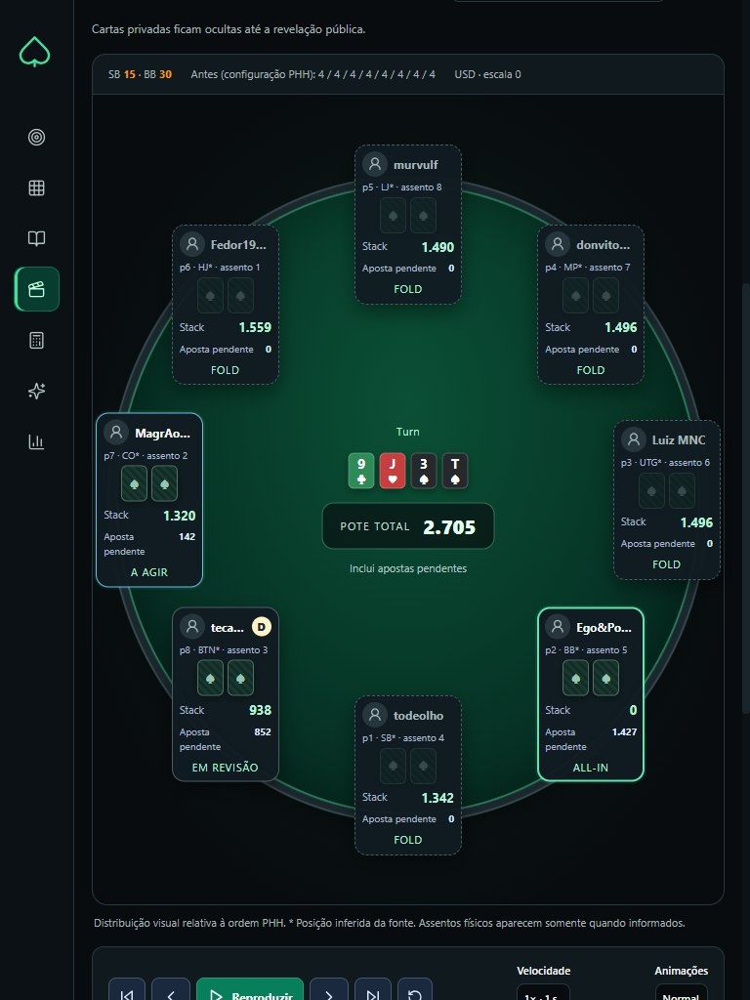
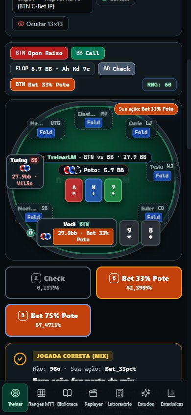
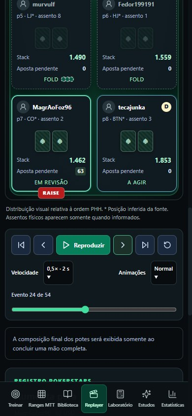

# Redesign visual global — TreinerLM

**Execução:** 17–18/11/2026, America/Fortaleza.  
**Escopo:** apresentação visual, navegação, responsividade e animações decorativas do Replayer.  
**Estado:** implementação, testes automatizados, build de produção isolado, verificação de preservação e inspeção visual no navegador concluídos (com limitações de ambiente detalhadas na Seção 8).

## 1. Identidade visual

A imagem fornecida foi usada como referência para a composição: navegação à esquerda, mesa central e coluna de ranges à direita. O tema usa preto/grafite, verde neutro nos elementos de interface, superfícies com bordas discretas, sombras reduzidas e tipografia consistente. Não foram reproduzidos dados ilustrativos, métricas, EVs ou frequências da imagem.

Os tokens globais atendem Trainer, Treiner Limpo, Ranges MTT, Biblioteca, Replayer, Lab EV & ICM, Laboratório Matemático, Currículo & 18 Aulas, Erros Fatais, TheNerdEinsten, Estatísticas, Configurações, tour e login. Os componentes existentes continuam fornecendo seu conteúdo e comportamento.

As cores semânticas das ações foram preservadas: All-in `#6D28D9`, Raise `#B91C1C`, Limp `#FACC15`, Fold `#1D4ED8`, Call `#047857`, Check `#475569` e Bet `#C2410C`. Os tokens de ações e o cálculo das distribuições não foram editados.

## 2. Navegação e Trainer

- Menu lateral recolhível no desktop (`224 px` expandido / `76 px` recolhido), com os sete domínios existentes e indicação de seleção.
- Barra lateral compacta em tablet (`768×1024`); navegação inferior em 7 colunas no celular (`390×844`).
- Cabeçalho compacto, mantendo fonte (`A−` / `100%` / `A+`), `Acesso rápido`, `Fazer um tour`, `Configurar TheNerdEinsten` e logout (quando autenticação ativa).
- Mesmos destinos, callbacks e submódulos da navegação anterior.
- Trainer com mesa central, matriz 13×13 no topo direito e controles/estatísticas abaixo da matriz no desktop (`grid-template-areas: "table range" "table controls"`); no celular o conteúdo segue em uma coluna, com a mesa antes dos painéis técnicos e `.poker-seat-hero` dimensionado para evitar quebra excessiva da pílula do herói sobre o board.
- Mesma proteção contra spoilers, botões de decisão e feedback com dados reais do catálogo.
- Atualização visual do feltro padrão legado (`#0B1B36`) para verde por CSS e exceção explícita em `.poker-dealt-card` para preservar o azul (`#60A5FA`) das cartas de ouros no estilo personalizado **Luxo Noir**. Cores personalizadas de feltro (como **Roxo Deepstack**) continuam funcionando normalmente.
- Ajustes de bordas, cartões, campos, tabelas e painéis recolhíveis compartilhados.

O ajuste de animações passou a ser compartilhado em memória entre os treinadores e o Replayer, com opções **Normal**, **Rápidas** e **Desligadas**. Ele não grava preferências ou altera a persistência das sessões. Componentes renderizados isoladamente mantêm uma preferência local de apresentação.

## 3. Replayer e camada de animação

A apresentação recebeu mesa verde, aro discreto, avatares, identificação dos jogadores, controles e linha do tempo harmonizados com o estúdio, além de ajuste específico para tablet (`701px`–`1099px`) e desktop (`>=1100px`) em mesas de 7 a 9 jogadores garantindo separação sem sobreposição entre assentos.

A camada de animação lê o evento já selecionado e atua somente em elementos decorativos do DOM:

| Ação registrada | Apresentação |
|---|---|
| Fold | Versos de cartas se deslocam em direção ao centro e desaparecem; nenhuma carta privada é copiada para as partículas |
| Call | Fichas se deslocam do assento para a área de apostas |
| Bet | Deslocamento de fichas e destaque temporário da aposta atual |
| Raise | Deslocamento de fichas, rótulo de aumento e destaque da aposta atual |
| All-in | Deslocamento de fichas e rótulo temporário ALL-IN |
| Check | Destaque breve do assento e rótulo CHECK |

As cores dos rótulos seguem a paleta semântica existente. O movimento usa transformações e opacidade, com duração limitada pela velocidade de reprodução. Não há dependência nova.

### Sincronização

- Somente um avanço sequencial explícito ou um tick de reprodução pode gerar uma animação.
- Seleção direta na linha do tempo, slider, início/fim, retrocesso e reinício apresentam o estado selecionado sem executar ações intermediárias.
- Eventos automáticos de coleta, devolução e distribuição de potes não recebem animações de decisão.
- Pausa, mudança de velocidade/perspectiva, próximo frame, troca de mão e desmontagem cancelam os efeitos em andamento.
- `prefers-reduced-motion` bloqueia os efeitos via CSS e `window.matchMedia`; uma mudança dessa preferência também cancela um efeito ativo.
- A opção **Desligadas** impede os efeitos decorativos. Nenhuma animação escreve nos snapshots, stacks, apostas, potes ou na lista de eventos.

## 4. Arquivos desta implementação

### Novos componentes de apresentação

- `app/src/components/StudioSidebar.tsx`: menu e apresentação responsiva dos destinos existentes.
- `app/src/components/StudioMotion.tsx`: preferência visual em memória, com suporte a componentes isolados.
- `app/src/components/replayMotion.ts`: classificação visual de decisões reais e guarda de avanço sequencial.
- `app/src/components/useReplayActionMotion.ts`: animações canceláveis via Web Animations API.
- `app/src/lib/__tests__/redesignPresentation.test.ts`: testes de classificação, ausência de mutação e bloqueio de saltos/retrocessos/eventos automáticos.

### Arquivos existentes editados

- `app/src/app/globals.css`: tokens, superfícies, layout, responsividade, exceção de cor em `.poker-dealt-card`, ajustes móveis em `.poker-seat-hero` e redução de movimento.
- `app/src/components/PokerStudioApp.tsx`: composição da navegação e provedor da preferência visual.
- `app/src/components/TrainerView.tsx`: identificação das regiões de layout e preferência visual compartilhada.
- `app/src/components/CleanRangeTrainerView.tsx`: classes de apresentação e preferência visual compartilhada.
- `app/src/components/CollapsiblePanel.tsx`: classe visual compartilhada.
- `app/src/components/ReplayerView.tsx`: elementos decorativos, preferência e intenção visual de navegação; o motor de transição permanece o existente.
- `app/src/components/ReplayerView.module.css`: mesa, assentos, controles, partículas e espaçamento responsivo para desktop (`>=1100px`) e tablet (`701px–1099px`).
- `app/src/components/MathLab.module.css`: tokens e estilo dos controles.
- `app/src/components/LoginView.tsx`: aplicação do tema ao contêiner visual.
- `app/eslint.config.mjs` e `app/.gitignore`: exclusão dos diretórios de build isolados `.next-redesign*` da análise de código e do versionamento.

Os demais módulos recebem o design pelo tema e pelos componentes compartilhados. Isso evita reconstruir formulários, consultas, calculadoras ou fluxos de estudo. As inclusões temporárias `.next-redesign/types/**/*.ts` e `.next-redesign-final/types/**/*.ts` adicionadas automaticamente pelo Next em `app/tsconfig.json` foram removidas ao encerramento, preservando a configuração anterior.

## 5. Testes e evidências

| Verificação | Resultado |
|---|---|
| Suíte Node/TypeScript (`npm test`) | **222/222 aprovados**, 43 suítes, sem falhas ou testes ignorados |
| Pipeline Python de históricos (`unittest`) | **78/78 aprovados** em 11,846 s |
| ESLint (`npm run lint`) | **Aprovado**, código 0, sem erros ou avisos |
| TypeScript (`npm run typecheck`) | **Aprovado**, código 0 (após limpeza do `app/tsconfig.json`) |
| Build de produção isolado (`NEXT_DIST_DIR=.next-redesign-final`) | **Aprovado**, código 0, compilado em 18,1 s após os ajustes finais de CSS |
| Integridade dos arquivos protegidos | **135/135 arquivos conferidos via SHA-256, nenhum alterado** |
| Banco SQLite pessoal (`hand-library.sqlite3`) | **SHA-256 idêntico antes/depois** (`815ef745f663b7f6aa9a41a33fa6bb54d85ec3bb5310a7ec3438ad1b4708cf06`, 33.370.112 bytes) |

Logs e manifestos estão em [redesign-visual-2026](redesign-visual-2026/): `tests.log`, `python.log`, `lint.log`, `typecheck.log`, `build.log`, `protected-baseline.json`, `preservation-result.json` e `personal-db-preservation.json`.

### Verificação efetivamente feita no navegador

- **Replayer com mão real PokerStars** (`.local/redesign-visual-2026/pokerstars-real.json`, 8 jogadores, 54 eventos) em servidor local isolado (`127.0.0.1:3100`, `POKER_LIBRARY_ENABLED=0`), mantendo **Visão pública** como padrão e cartas privadas ocultas.
- **Todas as seis ações animadas** validadas sequencialmente via seleção de `cursor - 1` + **Próximo evento** (`Fold` 20, `Raise` 24, `Call` 25, `Check` 31, `Bet` 38 e `All-in` 42), confirmando `[data-motion-active]`, rótulo semântico e limpeza automática sem duplicação ou revelação indevida de cartas privadas.
- **Saltos diretos e controles:** saltos `0 → 20` e `20 → 38` sem disparar animações intermediárias; reprodução e pausa, `Evento anterior`, `Voltar ao início`, `Ir ao final`, `Reiniciar mão`, troca de velocidade (`0,5×`, `1×`, `2×`), troca de perspectiva (`Visão pública`, `Jogador: Luiz MNC`, `Visão completa pós-sessão`), modo `Animações: Desligadas` e troca para outro exemplo do pipeline.
- **Trainer e personalização:** layout desktop (`1440×900` e `1920×1080`) com mesa à esquerda, matriz 13×13 no topo direito e controles/estatísticas abaixo da matriz; escolha de ação revelando matriz e frequências reais do solver; modo **Tela cheia** com saída por `Esc`; estilos personalizados **Luxo Noir** (confirmando `K♦` preservado em azul `#60A5FA`) e feltro **Roxo Deepstack**.
- **Todos os módulos, modais e navegação (`1440×900`):** `Treiner Limpo` (expansão/recolhimento da matriz), `Ranges MTT`, `Biblioteca` (estado desativado por `POKER_LIBRARY_ENABLED=0` legível e `Backup SQLite` desabilitado), `Lab EV & ICM`, `Laboratório Matemático`, `Currículo & 18 Aulas`, `Erros Fatais`, `TheNerdEinsten`, `Estatísticas`, `Recolher/Expandir menu`, `Acesso rápido`, `SiteTour` (etapas, destaque `[data-tour-active="true"]` e saída por `Esc`), `SettingsModal` (7 provedores de IA) e anel `:focus-visible` verde (`#40df9e`).
- **Responsividade após os ajustes finais de CSS:**
  - `1920×1080` e `1440×900`: sem overflow horizontal; no Replayer (8 jogadores, cursores 20 e 42), `outOfBoundsCount = 0`, `overlapCount = 0` e `boardOverlapCount = 0`.
  - `768×1024` (tablet): sem overflow horizontal; barra lateral compacta; no Replayer (8 jogadores, cursores 20 e 42), `outOfBoundsCount = 0`, `overlapCount = 0` e `boardOverlapCount = 0`.
  - `390×844` (celular): sem overflow horizontal (`382 px <= 390 px`); navegação inferior em 7 itens; pílula do herói no Trainer reduzida para `58,03 px` de altura com `33,31 px` de folga abaixo das cartas do board (`0` colisões); grade de 2 colunas no Replayer com `overlapCount = 0`.

## 6. Comparação visual

### Trainer — antes

### Trainer — depois (desktop 1920×1080 e 1440×900)

### Trainer — personalização Luxo Noir e feltro Roxo Deepstack

### Replayer — antes e depois (mão real PokerStars em 1440×900)

### Replayer — animação ativa ALL-IN (1440×900) e tablet (768×1024)

### Celular (390×844) — Trainer e Replayer

As capturas documentam os estados observados após os ajustes finais (exceto as capturas de personalização e das animações ativas, registradas no ensaio funcional do mesmo ciclo antes do ajuste apenas de altura/largura responsiva). As frequências e mãos exibidas são reais da aplicação, não da imagem de referência.

## 7. Preservação

Antes das alterações foi salvo um manifesto SHA-256 dos arquivos preexistentes em `app/src/lib`, `app/src/data`, `app/src/app/api`, `pipeline`, `windows` e do middleware. A comparação final após todos os ajustes encontrou **zero mudanças em 135 arquivos protegidos**.

Isso inclui fórmulas, equidade/EV/ICM/PKO, contratos, avaliação GTO, referências TexasSolver, ranges, pipeline PokerStars, persistência, configuração e segurança da IA, endpoints, autenticação e motor do Replayer.

O arquivo `.local/redesign-visual-2026/pokerstars-real.json` permanece apenas em área local ignorada pelo Git, sem inclusão em assets públicos e sem envio a provedores externos de IA. O hash do banco SQLite pessoal permaneceu idêntico (`815ef745...cf06`).

As alterações anteriores do workspace foram mantidas. Não houve commit, push ou publicação. O build de validação usou `.next-redesign-final`, preservando o build `app/.next` e o servidor pessoal na porta 3000 sem interrupções.

## 8. Limitações e riscos residuais

1. **`prefers-reduced-motion` no navegador:** a API `page.emulateMedia()` não é suportada pelo sandbox do navegador automatizado utilizado; o bloqueio por movimento reduzido foi conferido no código (`globals.css`, `ReplayerView.module.css` e listener `matchMedia` em `useReplayActionMotion.ts`), enquanto o desligamento explícito via seletor **Animações: Desligadas** foi confirmado ao vivo no navegador.
2. **Biblioteca com backend ativo:** na instância isolada de conferência (`POKER_LIBRARY_ENABLED=0`), foi validado o estado desativado/vazio da interface da Biblioteca; o pipeline de importação e consulta SQLite foi coberto pelos **78/78** testes Python.
3. **Tela `/login`:** sem `TREINERLM_ACCESS_PASSWORD` definida no servidor de teste local, `/login` redireciona no servidor para `/` conforme esperado; a apresentação de `LoginView` foi validada pelos testes de unidade (`accessAuth.test.ts`) e pela inspeção da regra `.studio-login` em `globals.css`.
4. **Input `range` sintético em automação:** durante o preenchimento sintético do `<input type="range">` pelo runner automatizado, o console registrou `IndexSizeError: Failed to execute 'setEnd' on 'Range'` ao tentar aplicar seleção textual em slider numérico; cliques e navegação pelos botões de evento/linha do tempo funcionaram sem erros.
5. **Instância pessoal em `app/.next` (porta 3000):** permaneceu intacta e em execução com o build anterior. Para aplicar o redesign nessa instância pessoal, basta reconstruir (`npm run build` em `app/`) e reiniciar o iniciador quando desejar.
